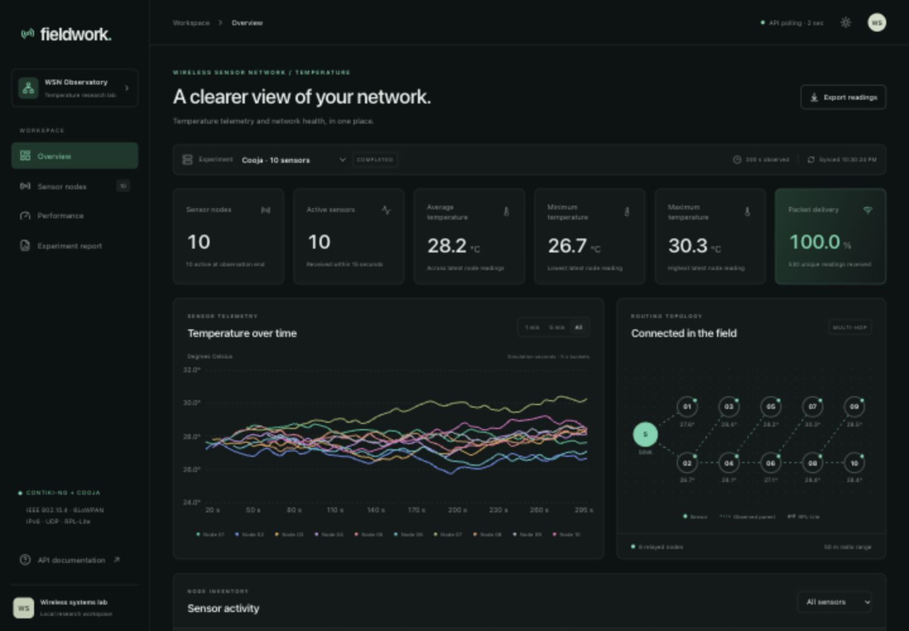
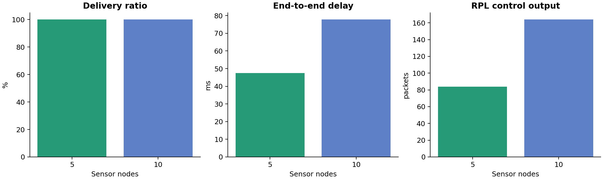

# Wireless Sensor Network with Real-Time Temperature Monitoring and Network Performance Analysis

An executable Contiki-NG/Cooja research project with 18-byte UDP sensor messages, RPL-Lite multi-hop routing, acknowledged retries, a FastAPI/SQLite telemetry backend, and a React observatory. All included performance results come from actual Cooja runs. Temperatures are simulated in the C firmware; the network is executed by Cooja.



## Open the project

From the cloned repository, install dependencies and start the application. Python 3.13 and a Vite-compatible Node release are required; the tested versions are listed below.

```bash
git clone https://github.com/Rishabh-0707/wsn-temperature-monitoring.git
cd wsn-temperature-monitoring
bash scripts/setup.sh
bash scripts/start_project.sh
```

Open **http://127.0.0.1:8001/**. The interactive API reference is **http://127.0.0.1:8001/docs**. Set `WSN_PORT` to change the default port.

The repository includes source, dependency lockfiles, documentation, and actual simulator logs/results. Dependencies, toolchain downloads, compiled output, and the local SQLite database are generated locally and excluded from Git. To populate a fresh database from the recorded experiments, run these commands in another terminal while the server is running:

```bash
.venv/bin/python scripts/bridge.py analysis/results/baseline_5/COOJA.testlog
.venv/bin/python scripts/bridge.py analysis/results/baseline_10/COOJA.testlog
```

Viewing these recorded results does not require a Contiki-NG installation. To execute new simulations, first install the pinned Contiki-NG/Cooja toolchain described in [implementation](docs/implementation.md), then select it:

```bash
export CONTIKI="$HOME/contiki-ng"
bash scripts/bootstrap_make.sh # if the host does not already have GNU Make 4+
# Optional: adapt the recorded, already-built Cooja checkout to an installed JDK 23.
python3 scripts/prepare_cooja_java23.py
```

With the backend running, execute and ingest a new experiment:

```bash
bash scripts/run_experiment.sh 5
bash scripts/run_experiment.sh 10
```

For actual live streaming, throttle Cooja to real-time speed while tailing its serial log:

```bash
bash scripts/run_live.sh 5 300
```

The dashboard polls every two seconds. Fast headless experiments can finish before one UI refresh; real-time mode deliberately takes the configured wall time. Completed runs remain selectable and are clearly marked historical. Node availability in a completed run is evaluated at simulation end.

## Results actually obtained

Both baseline configurations passed Cooja's all-sensors and multi-hop checks, plus an independent log/topology validator.

| 300-second baseline | 5 sensors | 10 sensors |
|---|---:|---:|
| Unique application packets transmitted | 279 | 530 |
| Unique packets received | 279 | 530 |
| PDR | 100% | 100% |
| Mean first-TX to first-RX delay | 47.45 ms | 77.81 ms |
| Useful payload throughput | 133.92 bit/s | 254.40 bit/s |
| Samples skipped without a route | 6 | 40 |
| RPL control output events | 84 | 164 |

100% PDR refers to **transmitted packets**, not every generated sample. Route formation prevented some samples from being sent. These are single-seed runs with ideal UDGM link-success settings; they are not evidence of perfect physical reliability.

The additional `lossy_5` run uses 0.6 radio TX success. It produced 80% PDR, eight retries, and route outages. It **failed** the all-sensors criterion, as documented in the results report. Electrical energy and lifetime are estimates, explicitly separated from measured times/counters.



## Components

| Directory | Purpose |
|---|---|
| `contiki/temperature-sensor/` | Timer-driven C sensor, random-walk temperature model, hardware hook, ACK/retry handling |
| `contiki/sink-node/` | RPL root, UDP parser, sequence checks, ACKs, JSON serial output |
| `contiki/common/` | Explicit-endian wire protocol, configuration, Energest/parent telemetry |
| `contiki/simulations/` | Five/ten-sensor configurations, placements, lossy and live variants |
| `backend/app/` | FastAPI validation, transactional SQLite, metrics, REST and CSV APIs |
| `frontend/` | React/Vite/Tailwind/Recharts dashboard; all data comes from the backend |
| `scripts/` | Setup, compilation/simulation, live streaming, replay, validation |
| `analysis/` | Shared metric analysis, CSV exports and standalone plots |
| `docs/` | Architecture, implementation guide, experimental results and full academic report |
| `tests/` | Metric, ingestion, validation and persistence regression tests |

## Toolchain and reproducibility

The existing installation at `~/contiki-ng` was reused, without changing its source. Tested revisions:

- Contiki-NG `735e87c3e5060e9c427b214e55c372967f595c04`.
- Cooja `be0f8d813271898c6b1cb7cfaec1f692e319a2ec`.
- Native Cooja motes on macOS arm64; system Clang; local GNU Make 4.4.1.
- Python 3.13.0, Node 26.10.0, npm 11.19.1. Dependency lockfiles are included.
- The existing Cooja jar targets Java 25. The final local launcher selects a separately compiled Java 23 compatibility jar; its ten-sensor regression reproduced the original results. Rebuild it with `python3 scripts/prepare_cooja_java23.py`. Java selection and host troubleshooting are described in [implementation](docs/implementation.md).

Use `source scripts/env.sh` from Bash to select the local tools, or explicitly set `CONTIKI` and `JAVA_HOME`. If building Cooja afresh, use its Gradle wrapper in the pinned checkout. The initial installation had unrelated modified submodules; no claim is made that it was a pristine upstream tree.

## Experiment controls

```bash
# New variant: 10 sensors, 10 minutes, 50 m range, different RNG seed.
.venv/bin/python scripts/generate_simulations.py \
  --nodes 10 --duration 600 --range 50 --seed 42 --suffix seed42
WSN_SIMULATION=contiki/simulations/wsn_10_nodes_seed42.csc \
  bash scripts/run_experiment.sh 10

# Analyze saved evidence without a running backend.
.venv/bin/python analysis/performance_analysis.py analysis/results/baseline_5
.venv/bin/python analysis/analyze_results.py \
  analysis/results/baseline_5 analysis/results/baseline_10

# Re-import an existing run; event and reading identities make this idempotent.
.venv/bin/python scripts/bridge.py analysis/results/baseline_5/COOJA.testlog
```

The default interval is five seconds. See `contiki/common/project-conf.h` and the implementation guide for compile-time overrides, temperature bounds and physical sensor integration. Changing firmware configuration requires a clean rebuild.

## Verify

```bash
.venv/bin/python -m pytest -q
cc -std=c99 -Wall -Wextra -Werror tests/protocol_test.c -o .runtime/protocol_test && .runtime/protocol_test
.venv/bin/python scripts/validate_simulation.py contiki/simulations/wsn_5_nodes.csc --results analysis/results/baseline_5
.venv/bin/python scripts/validate_simulation.py contiki/simulations/wsn_10_nodes.csc --results analysis/results/baseline_10
(cd frontend && npm run build)
```

Firmware compilation is part of every Cooja launch. Separate compilation commands are in [implementation](docs/implementation.md). Current executed evidence and remaining platform limitations are recorded in [PROJECT_STATUS.md](PROJECT_STATUS.md).

Read the [complete project report](docs/project_report.md), [results discussion](docs/experimental_results.md), and [architecture](docs/architecture.md). No physical hardware, calibrated electrical measurements, or public deployment is claimed. The default API is a local research service and has no authentication; keep it on loopback unless you add deployment access controls.
