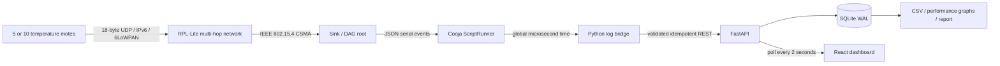

# Architecture and measurement design

The sink has Cooja mote ID 1. Sensors have mote IDs 2–11, exposed as logical node IDs 1–10. Two staggered rows spaced 35 m along x and 25 m along y form a ladder. A 50 m transmit range permits adjacent relays but prevents outer motes from reaching the root directly. The existing RPL-Lite implementation chooses and repairs routes. CSMA provides link retries, and the application uses an acknowledged, bounded retry protocol.

The binary UDP payload is 18 bytes: version u8, logical node ID u16, sequence u32, signed centi-degrees i16, sample uptime milliseconds u32, boot ID u32, attempt u8. All multi-byte values use explicit big-endian serialization; no packed structs or float formatting. The sink echoes the packet as an ACK. Node/boot/sequence uniquely identify a reading within one run. The bridge adds the run UUID and maps simulation time to a supplied UTC epoch. Hardware needs a time synchronization policy and a unique boot nonce before absolute timestamps can be trusted.

Both TX and RX events are required for measured PDR and end-to-end delay. Serial output from only the sink supports received counts and sequence-gap estimates, but cannot prove total sent packets. Such runs show unavailable measured PDR rather than fabricating it. Retries and duplicate receptions do not inflate PDR. The first TX and first RX timestamps define application delivery delay, including retry wait. Sequence gaps are per boot, include missing leading sequence numbers, and remain distinct from measured packet loss.

Energest supplies measured CPU, low-power, TX and listen durations. A configurable electrical model estimates joules and battery lifetime; Cooja motes are not a particular physical board. Routing overhead counts RPL DIS, DIO, DAO and DAO-ACK output calls from RPL INFO logs, not MAC frame transmissions or link retransmissions.

The API records all simulator events with deterministic identifiers. Replaying a log is idempotent. Experiment IDs separate trials, and dashboards explicitly select a run. The local service binds to loopback by default. Historical experiments use their last simulation time for node availability; they are visibly marked completed rather than presented as live hardware.
