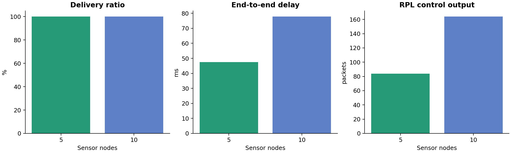
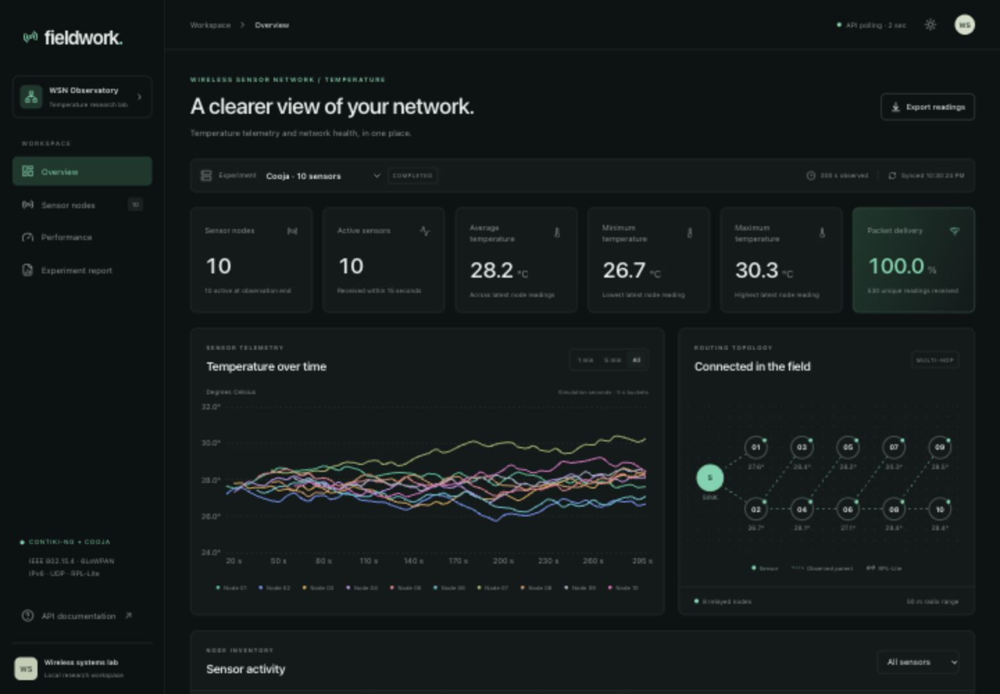

# Experimental results and evidence

All numbers below were computed from actual Cooja serial-event logs produced on 9 November 2026. The baseline seed is 123456. Each run lasts 300 simulated seconds. The radio model is UDGM with a 50 m transmit radius and 100 m interference radius. The payload is 18 bytes; sensors sample every five seconds after a staggered 15–20 second start.

## Baseline comparison

| Metric | 5 sensors | 10 sensors | Basis |
|---|---:|---:|---|
| Generated samples | 285 | 570 | Sensor sample events |
| Unique transmitted packets | 279 | 530 | Unique node/boot/sequence TX keys |
| Unique sink receptions | 279 | 530 | Unique RX keys |
| Lost transmitted packets | 0 | 0 | TX keys absent from RX |
| Packet delivery ratio | 100.00% | 100.00% | Received / transmitted |
| Packet loss ratio | 0.00% | 0.00% | Lost / transmitted |
| Samples skipped without a route | 6 | 40 | Explicit no-route events |
| Generated-sample collection ratio | 97.89% | 92.98% | Received / generated, separately derived |
| Mean delivery delay | 47.4539 ms | 77.8089 ms | First TX to first RX |
| Useful payload throughput | 133.92 bit/s | 254.40 bit/s | Unique received payload bits / 300 s |
| RPL control output events | 84 | 164 | DIS, DIO, DAO and DAO-ACK calls |
| Control outputs per transmitted packet | 0.3011 | 0.3094 | Control count / unique TX |
| Estimated network energy | 110.1501 J | 202.1078 J | Energest times × assumed currents; includes sink |
| Estimated first-sensor-depletion lifetime | 97.0953 h | 97.0945 h | Linear 2,000 mAh model |
| Active sensors at observation end | 5 | 10 | Last RX within 15 simulation seconds |
| Cooja validation | TEST OK | TEST OK | Every sensor received and multi-hop detected |

The ten-sensor experiment has greater average delay and more startup samples without routes. Its topology has more relay stages. This is consistent with longer paths and convergence, but two single-seed runs cannot establish statistical causality or a general scalability law. No confidence intervals or physical deployment claims are inferred.

The high PDR has a precise scope: once the application submitted a unique packet to UDP, every such packet reached the sink in these ideal-success baseline runs. It does not mean all generated temperature samples were collected. Treating leading sequence gaps as wireless packet loss would incorrectly mix route-unavailable samples with transmitted packets.

## Deliberately degraded radio experiment

The `lossy_5` experiment changed only UDGM TX success to 0.6 while retaining seed, duration and topology. It finished its observation window but **failed** Cooja's all-sensors acceptance criterion: only four of five sensors delivered a reading, although multi-hop was observed.

- 285 samples generated; 270 skipped because no route was available.
- 15 unique packets sent; 12 received; 3 lost; PDR 80.00%.
- 23 total application attempts, including 8 retries; 4 samples exhausted ACK attempts.
- Mean delay 107.362 ms among the 12 delivered packets; throughput 5.76 bit/s.
- 347 RPL control output calls; zero sensors active at simulation end.

ACK failure and data loss are different: a sink may receive data whose ACK never returns. The observed four ACK failures versus three missing data packets demonstrate why the report keeps these counters separate. A receive-only sequence-gap estimate also misses tail losses and samples never transmitted. The raw stress-test logs are retained as evidence of this behavior; they are not promoted to a passed baseline.

## Verification and reproducibility

Primary evidence directories:

- `analysis/results/baseline_5/`: original five-sensor Java 25 run.
- `analysis/results/baseline_10/`: original ten-sensor Java 25 run.
- `analysis/results/java23_10/`: isolated Java 23 Cooja build regression run.
- `analysis/results/live_verified_5/`: 60-second real-time streaming test, 39/39 packets, TEST OK.
- `analysis/results/lossy_5/`: completed degraded network, failed connectivity criterion.

Each baseline includes `COOJA.testlog`, simulator console output, run/config metadata, unique readings, parsed events, per-node metrics, a JSON summary, and performance graphs. A re-import of the five-sensor log inserted **zero new events**, verifying idempotency through the actual HTTP backend. Both baseline logs passed `scripts/validate_simulation.py`, which checks reception from sensors physically outside the sink's direct transmit range.

The Java 23 build uses unchanged Cooja sources compiled into a separate local jar. Its ten-node TX/RX totals, delay, throughput, routing count and energy estimate match the original baseline exactly. The real-time test took 60.081 wall seconds for 60 simulated seconds. A saved API snapshot at 28.72592 simulated seconds showed the run still running with nine readings and four active sensors; the browser subsequently showed 32 readings before completion. The final run collected 39/39 packets and all five sensors were active. Records of unsuccessful host startup attempts are distinct from completed network experiments.

## Dashboard integration evidence

The final production bundle was built successfully and served by the same FastAPI process as the API on port 8001. After a server restart, every monitoring GET endpoint and the generated static assets returned HTTP 200, and the ten-sensor dataset retained all 530 readings. `analysis/results/production_http_check.json` records that check. Browser verification covered dark/light themes, experiment and sensor filters, time windows, navigation, live polling, and a CSV download with the expected 39 rows from the live experiment. The 390 px mobile and 1440 px desktop layouts had no page-wide overflow. The final production page had no captured console errors.

## Measurement limits

Energest durations are observed simulator accounting; electrical current, battery capacity, and resulting lifetime are assumptions. The native Cooja platform does not emulate a calibrated MCU's complete sleep behavior. CSMA spends much of its time listening, and the simple model yields similar per-sensor power in both sizes. Energy is accumulated only through the last available Energest sample per node; it may omit the final fraction of a sample interval. The estimated lifetime is linear and excludes battery aging, self-discharge, voltage variation and temperature effects.

The reported throughput excludes protocol headers, ACK payloads, relayed copies and retransmissions. Routing overhead is a count of RPL output calls rather than an over-the-air byte total. Results apply to these recorded seeds, topology and firmware settings. Multiple seeds, longer windows, calibrated radios, and confidence intervals are necessary for broader academic conclusions.
