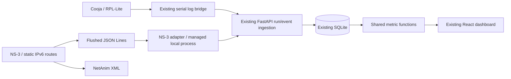

# Dual-simulator architecture

Both engines feed the existing run/event/readings tables and dashboard. Existing Cooja firmware, bridge, archived results and metadata stay unchanged. `source` remains backward compatible; API responses expose `simulator` inferred for legacy Cooja runs without rewriting stored JSON. NS-3 runs explicitly record both fields.

The process manager invokes one fixed executable with an argument list, never a shell. Configuration is typed and bounded; packet size is fixed to 18 bytes. Each run receives a new UUID and its own result directory. A single managed simulation may execute at a time. Cancellation terminates then kills an unresponsive child after a bounded wait. Startup marks previously managed running jobs interrupted. This manager is intended for one local Uvicorn process, not a multi-worker/public service.

A separate JSON Lines CLI adapter replays recordings over the existing REST ingestion API and uses its bounded HTTP retry utility. Embedded provenance must match the manifest. Event IDs and reading identities preserve idempotency and experiment isolation.
