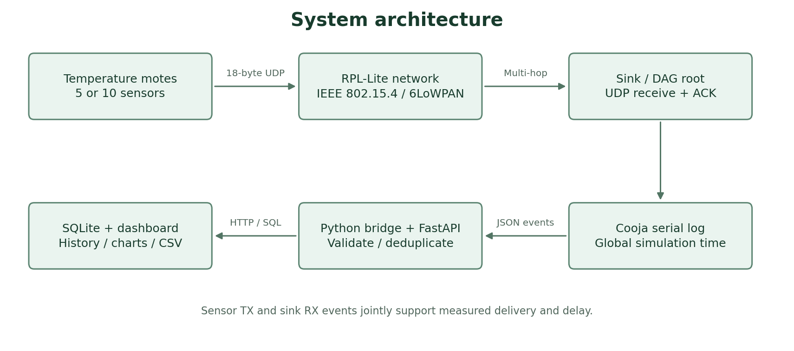
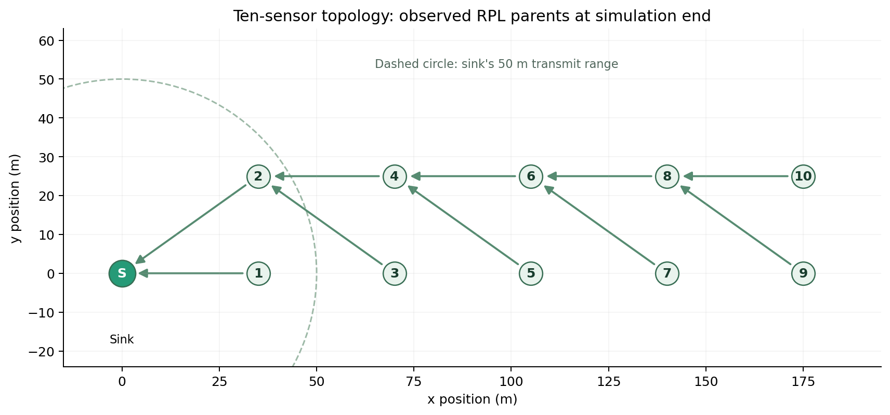
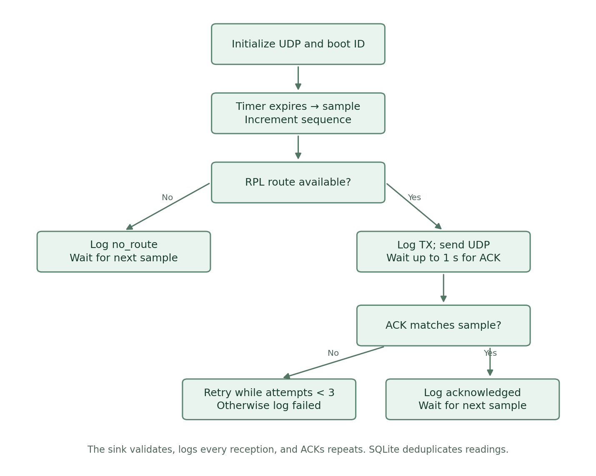
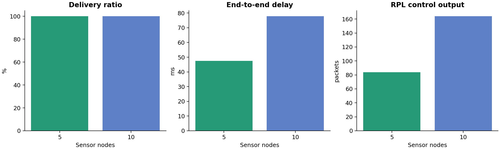

# Wireless Sensor Network with Real-Time Temperature Monitoring and Network Performance Analysis

**Project report · 9 November 2026**

**Implementation:** Contiki-NG, Cooja, C, IPv6/6LoWPAN/UDP/RPL-Lite, Python/FastAPI, SQLite, React/Vite/Tailwind/Recharts.

## Abstract

This project implements an executable wireless sensor network that collects periodic temperature readings and exposes both sensor data and network-performance evidence through a monitoring application. Five- and ten-sensor Cooja configurations connect to a central RPL root through a deliberately multi-hop topology. Each C sensor process generates a bounded temperature signal, serializes an 18-byte UDP message, and performs a limited number of acknowledged transmission attempts. The sink validates messages, emits structured reception logs, and acknowledges duplicate receptions. A Python bridge captures Cooja's globally timestamped events and forwards them to a validated REST API backed by SQLite. A responsive React dashboard displays experiment status, temperature trends, node availability, routing parents and performance metrics.

Both 300-second baseline simulations delivered every transmitted application packet: 279 of 279 packets with five sensors and 530 of 530 with ten sensors. Mean delivery delays were 47.45 ms and 77.81 ms. The system also recorded six and forty generated samples that could not be sent during route formation, preventing those omissions from being hidden by a high packet-delivery ratio. A degraded-radio experiment exercised retries and produced route outages, demonstrating that successful receipt, acknowledgement and network availability are separate outcomes. Energy and lifetime are explicitly presented as estimates derived from measured activity times and declared electrical assumptions. The deliverable includes source, configurations, raw logs, tests, CSV exports, standalone graphs and reproduction instructions.

## 1. Introduction

Wireless sensor networks provide distributed observations where wiring every measurement location is inconvenient. Temperature monitoring is an accessible application, but a temperature graph alone cannot show whether the network is reliable. A missing reading can result from no available route, radio failure, acknowledgement loss, a node reboot, or an ingestion problem. These causes require different evidence and should not be collapsed into a single unexplained percentage.

This implementation connects the embedded network and the monitoring application through an auditable event pipeline. It uses real Contiki-NG application code inside Cooja, rather than replacing the radio network with a Python random-number generator. Temperature values are deliberately simulated in firmware because the native Cooja mote has no physical sensor. The communication stack, routing behavior, packet transport and event timing are executed by the simulator.

The architecture is suitable for teaching protocol layers, studying constrained-device serialization, and performing controlled network experiments. It also creates a defined adaptation point for later physical hardware. Simulation evidence and hardware evidence remain separate throughout the report.

## 2. Problem statement

The project must collect temperature readings from several nodes, including nodes that cannot directly reach a sink, while preserving enough information to evaluate delivery and performance. It must provide a working end-to-end path from embedded code to a persistent, interactive dashboard. Its results must be reproducible and distinguish observed counters from model-based estimates.

Three practical measurement problems guide the design. First, a sink cannot observe packets that were never received, so receive-only logs cannot prove the sent-packet denominator. Second, retries and duplicate packets can inflate received totals unless application identity is preserved. Third, node-local uptime is not automatically a synchronized clock, so subtracting different motes' timestamps can create invalid delays. The project solves these problems using source and sink events, stable identities within a run, and Cooja's global clock.

## 3. Objectives

1. Implement periodic, configurable temperature sampling in Contiki-NG C processes.
2. Deliver compact messages through IEEE 802.15.4, 6LoWPAN, IPv6, UDP and existing RPL-Lite routing.
3. Support explicit node identities, boot sessions, sequence numbers, ACKs and bounded retries.
4. Create reproducible five- and ten-sensor multi-hop simulations.
5. Persist validated readings and telemetry in SQLite through REST endpoints.
6. Display actual backend values in a responsive dashboard with history, filtering and themes.
7. Calculate delivery, loss, delay, throughput, routing overhead and transparent energy/lifetime estimates.
8. Preserve raw evidence, export CSVs, and verify the complete software path.

## 4. Existing system and its limitations

A minimal sensor demonstration typically prints a received value to a serial console. Such a demonstration is useful for connectivity checks but leaves the researcher to collect logs manually, infer missing packets, and reconstruct node history. A fixed star topology also avoids the routing challenge posed by nodes outside direct range. Adding a dashboard without a measurement contract does not resolve these weaknesses: it can simply make incomplete counters more visually convincing.

The baseline reference for implementation was the installed Contiki-NG `rpl-udp` example, which initializes simple UDP connections and sends toward a discovered DAG root. Its existing conventions were retained, then extended with application identity, binary serialization, ACK handling, source/sink telemetry, persistence and analysis. This report does not claim a benchmark against an external product or an unimplemented historical system; the comparison is architectural and functional.

## 5. Proposed system

Each sensor runs an event-driven process. A timer triggers a new sample and sequence number. If RPL reports reachability, the node sends its compact message and waits for an application ACK. It retries at most twice after the initial attempt. If no route exists, it records the sample omission explicitly and waits for the next interval. Nodes continue participating in Contiki's routing stack while application timers wait.

The sink initializes the DAG root, validates UDP payloads, tracks sequence progress and echoes valid messages as ACKs. It logs every valid reception, including potential duplicates, because deduplication belongs to the durable collector. The simulator records both source and sink messages with a common clock. The bridge submits idempotent batches to the backend, and the frontend polls the API every two seconds.

## 6. System architecture

The system has four layers. The embedded layer contains temperature acquisition, serialization and retry state. The network layer is Contiki-NG's existing 6LoWPAN/IPv6/UDP/RPL-Lite stack over the Cooja radio model. The collection layer transforms serial telemetry into validated transactions. The presentation and analysis layer reads the same retained evidence for charts, CSVs and numerical summaries.

Run identifiers separate experiments. Within a run, a reading is keyed by logical node ID, boot ID and sequence number. An event additionally has a deterministic identity derived from its source log line. Replaying a recorded experiment therefore leaves both counters and readings unchanged. SQLite's transactional batches ensure that an invalid event does not leave a partially accepted batch.

The frontend selects a run explicitly. Completed experiments are marked historical and evaluate node availability at simulation end. This prevents an old successful experiment from being mislabeled as a currently operating physical deployment. For Cooja, chart time is simulation elapsed time; ISO receipt timestamps are mapped from a declared run epoch.

## 7. Hardware and software requirements

No physical motes are required for the supplied experiments. A host needs a C compiler, GNU Make 4 or later, a suitable Java runtime for Cooja, Python, Node.js and enough memory for the Java simulator and browser. The verified host is macOS arm64 with Python 3.13.0 and Node 26.10.0. The precise dependency graph is retained in the Python and npm lockfiles.

The existing Contiki-NG revision was `735e87c3e5060e9c427b214e55c372967f595c04`; Cooja was `be0f8d813271898c6b1cb7cfaec1f692e319a2ec`. Both applications were compiled for the native `cooja` target. The original installed Cooja jar required Java 25. An isolated jar was also compiled from the unchanged Cooja sources for the installed Java 23 runtime and tested with the ten-sensor configuration. This compatibility build leaves the user's original source and jar untouched.

Later hardware deployment requires a supported IEEE 802.15.4 board, a temperature sensor and driver, a sink serial connection or border-router adapter, a unique boot identity scheme and an appropriate clock-synchronization policy. None of these physical components were fabricated or claimed as tested.

## 8. Wireless communication protocols

IEEE 802.15.4 supplies the constrained radio link in the simulation. The selected MAC is CSMA. Contiki's 6LoWPAN adaptation supports IPv6 transport over these small frames. UDP provides an application datagram interface, and the application implements its own acknowledgement/retry policy. The 18-byte payload limits overhead and avoids on-device JSON parsing and floating-point serialization.

6LoWPAN header compression is designed to reduce IPv6 and UDP overhead on constrained links. The implementation delegates this layer to Contiki-NG rather than reimplementing packet compression. [RFC 6282](https://www.rfc-editor.org/rfc/rfc6282) defines the relevant compression format. The reported application throughput counts useful payload bytes only; it should not be interpreted as total link utilization.

## 9. RPL routing

RPL organizes low-power, lossy IPv6 networks around a directed acyclic graph rooted at a sink. Nodes select parents and advertise routing information through control messages. This project uses Contiki-NG's RPL-Lite implementation, with no custom routing algorithm. [RFC 6550](https://www.rfc-editor.org/rfc/rfc6550) provides the foundational protocol definition.

The topology is a two-row ladder. Nodes are spaced 35 m horizontally and 25 m vertically. The sink is at the origin, and the transmit range is 50 m. In the ten-sensor experiment, logical nodes 3–10 lie beyond the sink's direct transmit radius. Their successful sink receptions, together with non-root parent telemetry, establish multi-hop operation. The final observed parent links are shown below; these are measured selections, not predefined routes.

Rank values are retained for inspection but are not equated to hop counts. The stress experiment demonstrates that parent discovery and route reachability can degrade when radio success is reduced. The baseline results alone do not establish performance under mobility or node failures.

## 10. Implementation details

### Sensor and sink

The sensor starts sampling after a randomized 15–20 second delay, then uses a five-second interval. Its temperature source performs a bounded random walk in centi-degrees. The default range is 20–35 °C, and each sample changes by at most 0.30 °C. Values are reproducible for a fixed simulator seed and execution path. A compile-time hardware hook replaces this function when a board-specific driver is supplied.

The wire format contains version, node ID, sequence, signed centi-degree temperature, sample uptime, boot nonce and attempt number. Explicit big-endian helpers avoid structure padding and host endianness assumptions. The sink checks payload size and field bounds before logging or acknowledging. ACK matching verifies the root address and message content. A delayed ACK from an earlier attempt still acknowledges the same reading.

### Backend and database

FastAPI uses typed validation for sensor values, IDs, timestamps and telemetry fields. Timestamps require timezone information. The SQLite schema stores experiment metadata, raw parsed events and unique readings. It uses foreign keys, WAL mode, time indexes and transactions. The API exposes all six requested endpoints plus experiment management, coherent dashboard snapshots and CSV export.

The metric service is shared with offline analysis so that the dashboard and exported report apply the same definitions. Unit tests verify the definitions against independently calculated expected values. The direct reading endpoint supports receive-only integrations; it deliberately leaves transmitted-packet metrics unavailable when their denominator has not been measured.

### Frontend

The React interface contains six overview cards, an interactive temperature chart, observed parent topology, a node table, a recent-reading view and a performance/report view. Experiment selection, node filtering, chart time windows, CSV download and light/dark themes are implemented. Requests are cancelled on experiment changes. A failed refresh retains the last successful data and marks the connection problem visibly.

Charts bucket readings into five-second display points, while CSV exports preserve every stored reading. The UI contains no hardcoded measurement values. Simulated temperatures, measured network counters and model-based energy estimates remain labeled according to their source.

## 11. Simulation setup

The baseline suite contains one sink plus either five or ten sensors, seed 123456, 300 simulated seconds, 50 m transmit range, 100 m interference range and ideal UDGM transmit/receive success ratios. Startup and convergence are included in the observation window. The generator also permits different seeds, durations, ranges and success probabilities. A real-time speed setting supports streaming demonstrations.

Cooja's ScriptRunner writes a global microsecond timestamp, originating mote and serial message for every captured event. At the end, it records how many sensors reached the sink and whether a non-root parent was observed. Baseline acceptance requires every configured sensor and multi-hop evidence. An independent validator also checks the XML structure, mote identities and reception from outside direct range.

Each experiment stores raw logs and metadata before analysis. Newer runner manifests additionally record firmware hashes, Java version and the selected Cooja jar hash. Output directories cannot be silently reused, preventing accidental overwriting of prior evidence.

## 12. Results and discussion

| Baseline metric | 5 sensors | 10 sensors |
|---|---:|---:|
| Generated temperature samples | 285 | 570 |
| Unique transmitted / received packets | 279 / 279 | 530 / 530 |
| PDR | 100.00% | 100.00% |
| No-route sample omissions | 6 | 40 |
| Mean end-to-end delay | 47.45 ms | 77.81 ms |
| Useful payload throughput | 133.92 bit/s | 254.40 bit/s |
| RPL control output calls | 84 | 164 |
| Estimated network energy, including sink | 110.15 J | 202.11 J |

Both baselines passed Cooja and independent evidence validation. The larger topology increased total useful throughput because it contained more senders, while mean delay increased with the additional relay structure. More startup samples were omitted without routes. These observations are compatible with longer convergence paths, but the limited experimental design does not isolate every cause of the delay difference.

The degraded five-sensor experiment reduced radio TX success to 0.6. It generated 285 samples but sent only 15 unique packets; twelve arrived. Eight application retries and four exhausted ACK sequences were observed. Only four sensors delivered any data, and all were offline at the end. Its all-sensors validation failed, correctly exposing a network outage instead of presenting it as a passing result.

This stress case shows why multiple denominators matter. An 80% PDR among transmitted packets can coexist with severe application data unavailability when most samples cannot be sent. The report therefore exposes generated samples, no-route omissions, transmitted packets, received packets and ACK failures separately.

## 13. Performance evaluation

### Packet delivery and loss

Let S be the set of unique application keys observed in TX events, and R the set observed at the sink. For complete transmit telemetry:

`PDR = |S ∩ R| / |S| × 100`

`Packet loss ratio = |S − R| / |S| × 100`

Retries reuse the same key and do not increase S. Duplicate receptions do not increase R. If S is empty, the percentage is unavailable rather than forced to zero or one hundred. Received keys without matching transmit evidence are reported separately. Sequence gaps are a receive-only diagnostic and are not substituted for measured packet loss.

### Delay and throughput

`Mean delay = Σ(first RX time − first TX time) / delivered packets with matching timestamps`

The clock is Cooja's global time. Delay includes an application retry wait when the first attempt fails. It excludes any waiting before the first TX, including route formation before transmission.

`Throughput = Σ(unique received payload bytes × 8) / observation duration`

The full 300-second interval is used for completed baselines. Thus warm-up and convergence reduce the achieved useful throughput. MAC/IP headers, acknowledgements, relayed copies and retransmissions are not counted as useful payload.

### Energy consumption and lifetime

Energest records the duration of CPU, low-power, deep-low-power, radio-transmit and radio-listen states. The official [Energest documentation](https://docs.contiki-ng.org/en/master/doc/programming/Energest.html) explains this activity-time accounting. Current and voltage values must come from a separate electrical model; software time measurements alone are not electrical measurements.

The illustrative model assumes 3.0 V, CPU current 1.8 mA, low-power current 0.005 mA, deep-low-power current 0.001 mA, transmit current 17.4 mA, listen current 18.8 mA and a 2,000 mAh battery. CPU and radio currents are additive components:

`E = V × Σ(I_state × t_state)`

`Mean power = E / measured state-accounting duration`

`Estimated lifetime = battery energy / mean power`

Network lifetime is defined as the minimum estimated sensor lifetime; the sink is excluded from that minimum. Network energy includes the sink. The latest available cumulative sample for each boot is used, so the tail of the experiment may be shorter than the full observation window. The approximately 97-hour results are illustrative linear estimates, not validated battery-life predictions.

### Routing overhead

RPL INFO messages identify DIS, DIO, DAO and DAO-ACK output calls. The main overhead measure is control outputs per unique transmitted application packet. It is a logical-message measure: forwarded frames, link retries, control byte sizes and radio airtime require separate packet-level instrumentation. The definitions intentionally avoid presenting these counts as total on-air overhead.

## 14. Testing and validation

Both embedded applications were compiled with the actual Contiki-NG build system. The five- and ten-sensor configurations were loaded and executed in Cooja. Source TX and sink RX events, parent telemetry, beyond-range receptions and final test markers were inspected. The Python bridge imported 1,900 and 3,622 baseline events through HTTP, and a repeated import inserted zero new events.

Eight Python tests cover delivery calculations, retries, duplicate receptions, missing sequences, out-of-order recovery, boot resets, request validation, transaction rollback, SQLite persistence across application restarts, receive-only behavior, energy arithmetic, partial live-log lines and stopped producers. A C test verifies exact byte serialization and negative temperatures. Browser interaction checks verified backend-driven values, experiment switching, sensor/time filtering, theme changes, history navigation and CSV download. The 390-pixel mobile viewport had no page-wide overflow, and the downloaded CSV contained the expected 39 readings. Final build evidence is recorded in the status file.

The real-time integration run took 60.081 wall seconds for 60 simulated seconds and delivered 39/39 packets. An API snapshot taken while it was still running showed nine received samples at 28.7 simulated seconds; the browser later showed 32 before completion. This confirms that log forwarding and UI polling work during execution, not only after batch import. The headless Cooja launcher resets XML speed limits, so the simulation script reapplies the requested rate after startup.

Host failures were also recorded. The initial macOS Make was too old; a local supported Make was built. The installed Cooja jar required a newer Java than the default runtime; an isolated compatible-source build was prepared and verified. Unsuccessful startup attempts and the intentionally failed network stress case are not counted as passed tests. The status file is the authoritative list of executed checks and remaining platform limitations.

## 15. Advantages and limitations

The project provides an auditable connection between embedded behavior and monitoring statistics. It supports multi-hop routing without inventing a new protocol, makes failed attempts visible, persists data across restarts and keeps replay idempotent. Separate experiments, boot IDs and timestamp semantics reduce common analysis errors. CSV and image artifacts make the results usable outside the dashboard.

The main limitations are scope and model fidelity. Native Cooja motes do not reproduce every physical board behavior. Temperature is an artificial signal. UDGM does not represent a measured deployment environment. The baseline is one seed per size, so statistical confidence and general performance claims are limited. The energy model is uncalibrated, CSMA spends substantial time listening, and runtime node availability is a threshold-based diagnostic.

The API is intended for local research and binds to loopback; it does not include a production authentication layer. Metrics load a run's records in memory, appropriate for these experiments but requiring aggregation/retention work for long-term deployments. Hardware drivers, clock synchronization, security hardening, radio duty cycling and large-scale trials remain outside the tested deliverable.

## 16. Future scope

Future experiments should sweep several seeds, topology densities, sample intervals and radio-loss settings, then report confidence intervals and convergence distributions. TSCH/Orchestra can provide a useful comparison with CSMA. A controlled node-failure or mobility experiment would measure route repair more directly than a static baseline.

Physical deployment should add a real sensor driver, persistent boot counters, address-to-node mapping and synchronized timestamps. Current traces from a power analyzer could calibrate the Energest model. Packet capture would permit byte-level routing overhead and channel-utilization analysis. Longer experiments could examine queueing, node depletion, history retention and operational alerting.

## 17. Conclusion

The project implements the requested end-to-end temperature-monitoring network with executable Contiki-NG applications, real Cooja multi-hop experiments, durable telemetry collection, an interactive dashboard and reproducible analysis. Both baseline sizes passed network validation, while the degraded-radio case exposed meaningful failure behavior. Explicit metric definitions prevent a high transmitted-packet PDR from concealing samples lost before transmission. The resulting artifacts support further research while preserving the boundary between simulated observations and estimated physical behavior.

## 18. References and reproducibility artifacts

1. Contiki-NG, [RPL-UDP example](https://docs.contiki-ng.org/en/release-v4.9/examples/rpl-udp/README.html), supplemented by the actual installed source revision recorded above.
2. Contiki-NG, [Running a RPL network in Cooja](https://github.com/contiki-ng/contiki-ng/blob/develop/doc/tutorials/Running-a-RPL-network-in-Cooja.md).
3. Winter et al., [RFC 6550: RPL](https://www.rfc-editor.org/rfc/rfc6550), 2012.
4. Hui and Thubert, [RFC 6282: IPv6 compression over IEEE 802.15.4](https://www.rfc-editor.org/rfc/rfc6282), 2011.
5. Contiki-NG, [Energest programming documentation](https://docs.contiki-ng.org/en/master/doc/programming/Energest.html).
6. Vite, [Getting Started](https://vite.dev/guide/), consulted for frontend runtime compatibility.
7. Project artifacts: [experimental results](experimental_results.md), [implementation guide](implementation.md), [status and test evidence](../PROJECT_STATUS.md), and raw experiment directories under `analysis/results/`.
